# Yui (結)

[日本語](README.ja.md)

**Tie text and UI together.** Yui is a tiny notation for drawing figures inside Markdown with a ` ```ui ` block, plus a parser, an SVG renderer and React components.
Drop it into a chat UI or a Markdown editor the same way you use a Markdown renderer.

````md
```ui
bar Revenue and profit by quarter
unit: $M
Quarter | Revenue | Profit
Q1 | 120 | 30
Q2 | 150 | -5
```
````

- **The model writes data, not layout.** Placement, colors and axes are the renderer's job, so even small models get it right from a short prompt.
- **Accepts what models already write.** Markdown tables, bullet lists, Mermaid-style arrows and Japanese number formats (`1億2,000万円`, `△120`) just work.
- **Renders while streaming.** Lines are committed one by one; a figure only grows and never shows a half-written value.
- **Safe for any input.** No HTML, URLs or scripts — only text and numbers end up on screen.

npm: [`@imanect/yui`](https://www.npmjs.com/package/@imanect/yui)

## Figure kinds

### `bar`

Bar chart. Negative values grow below the baseline; many rows or long labels turn it horizontal.

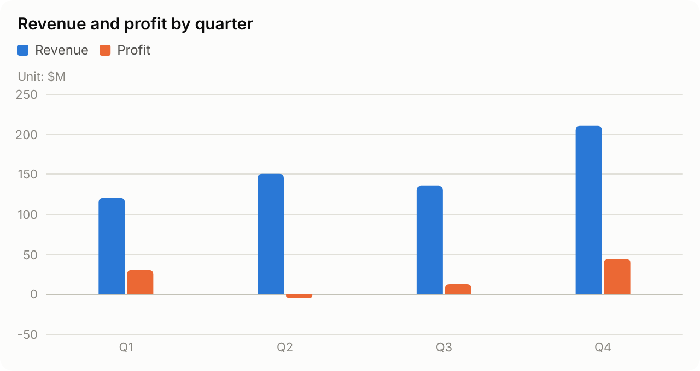

````md
```ui
bar Revenue and profit by quarter
unit: $M
Quarter | Revenue | Profit
Q1 | 120 | 30
Q2 | 150 | -5
Q3 | 135 | 12
Q4 | 210 | 44
```
````

### `line`

Line chart. Two or more series get a legend.

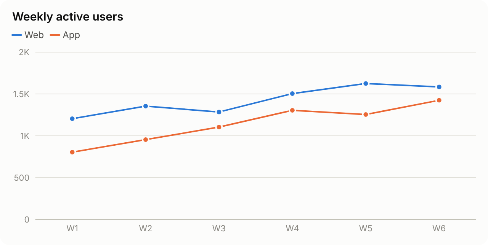

````md
```ui
line Weekly active users
Week | Web | App
W1 | 1200 | 800
W2 | 1350 | 950
W3 | 1280 | 1100
W4 | 1500 | 1300
W5 | 1620 | 1250
W6 | 1580 | 1420
```
````

### `pie`

Donut chart for shares of a whole. The center shows the total; the legend lists each value and its percentage. Slices keep the order you write them in.

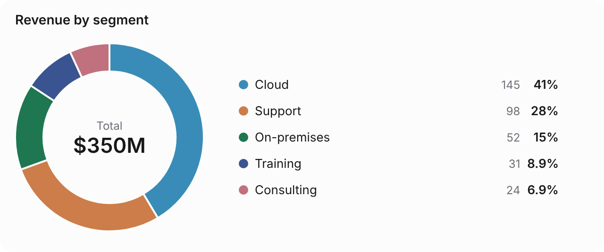

````md
```ui
pie Revenue by segment
unit: $M
Segment | Revenue
Cloud | 145
Support | 98
On-premises | 52
Training | 31
Consulting | 24
```
````

### `scatter`

Scatter plot for the relation between two quantities. A 4th column colors points by group; with up to 15 points, names sit next to the dots.

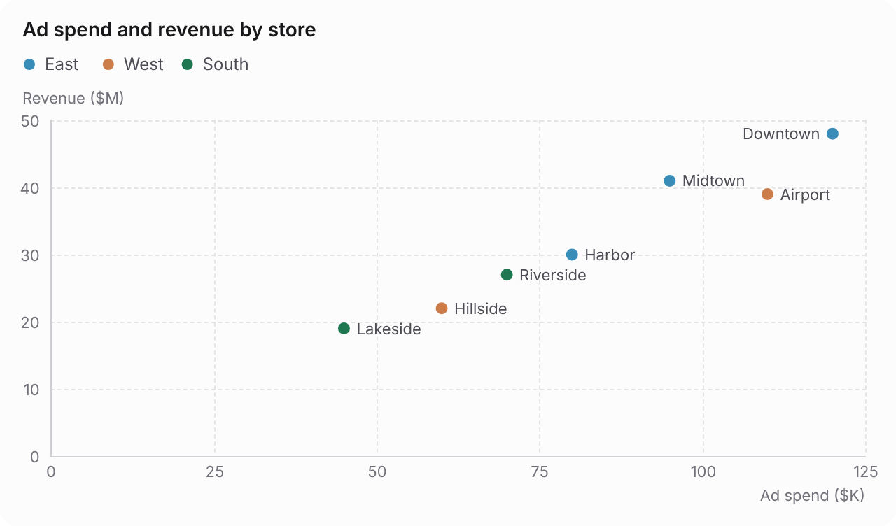

````md
```ui
scatter Ad spend and revenue by store
Store | Ad spend ($K) | Revenue ($M) | Region
Downtown | 120 | 48 | East
Midtown | 95 | 41 | East
Harbor | 80 | 30 | East
Airport | 110 | 39 | West
Hillside | 60 | 22 | West
Lakeside | 45 | 19 | South
Riverside | 70 | 27 | South
```
````

### `stat`

KPI cards. Values are shown as written; the third column is a note.

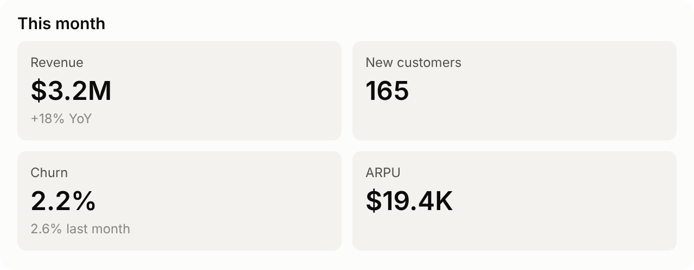

````md
```ui
stat This month
Revenue | $3.2M | +18% YoY
New customers | 165
Churn | 2.2% | 2.6% last month
ARPU | $19.4K
```
````

### `flow`

Flowchart. Branches become diamonds, labels sit where the edge leaves, and loops route around the side. Wrap stages in `subgraph Name` … `end` to draw dashed, colored frames (edges between frames route through the gaps), and mark a box with `**Name**` to emphasize it.

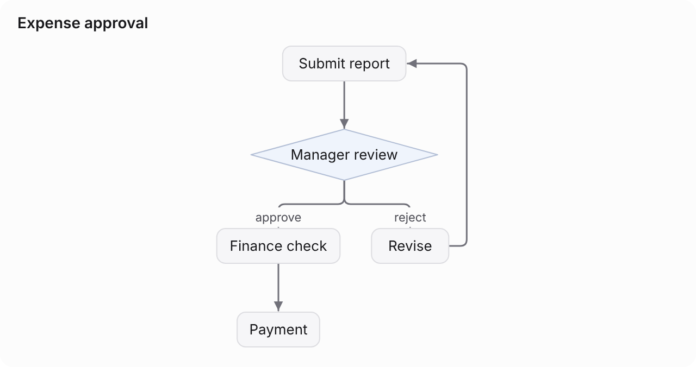

````md
```ui
flow Expense approval
Submit report -> Manager review
Manager review -approve-> Finance check -> Payment
Manager review -reject-> Revise
Revise -> Submit report
```
````

### `stack`

Layered architecture diagram. Indented items go inside a layer; `|` puts boxes side by side.

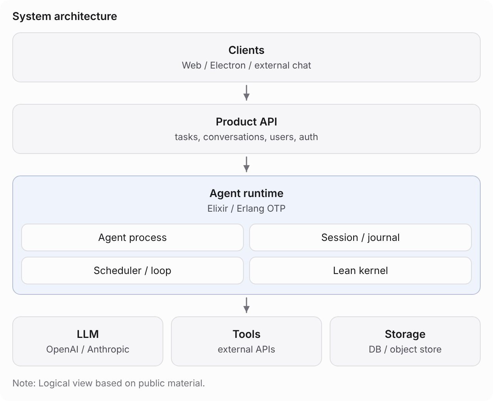

````md
```ui
stack System architecture
- Clients: Web / Electron / external chat
- Product API: tasks, conversations, users, auth
- Agent runtime: Elixir / Erlang OTP
  - Agent process
  - Session / journal
  - Scheduler / loop
  - Lean kernel
- LLM: OpenAI / Anthropic | Tools: external APIs | Storage: DB / object store
note: Logical view based on public material.
```
````

### `timeline`

Timeline for history, schedules and time-ordered events. Kept in the written order; few short events go horizontal.

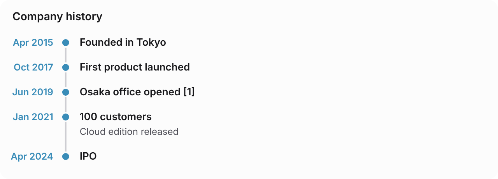

````md
```ui
timeline Company history
- Apr 2015: Founded in Tokyo
- Oct 2017: First product launched
- Jun 2019: Osaka office opened [1]
- Jan 2021: 100 customers
  Cloud edition released
- Apr 2024: IPO
```
````

### `steps`

Numbered steps for a procedure without branches (use `flow` for branches and loops).

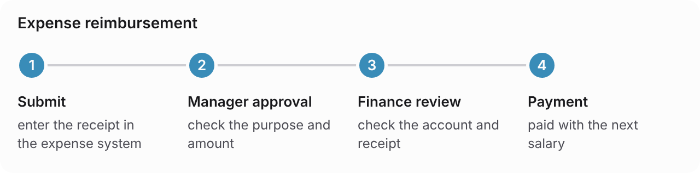

````md
```ui
steps Expense reimbursement
1. Submit: enter the receipt in the expense system
2. Manager approval: check the purpose and amount
3. Finance review: check the account and receipt
4. Payment: paid with the next salary
```
````

### `tree`

Hierarchy for org charts, categories and tables of contents. Indentation is the depth (up to 4 levels); it becomes an org chart when it fits, otherwise an indented outline.

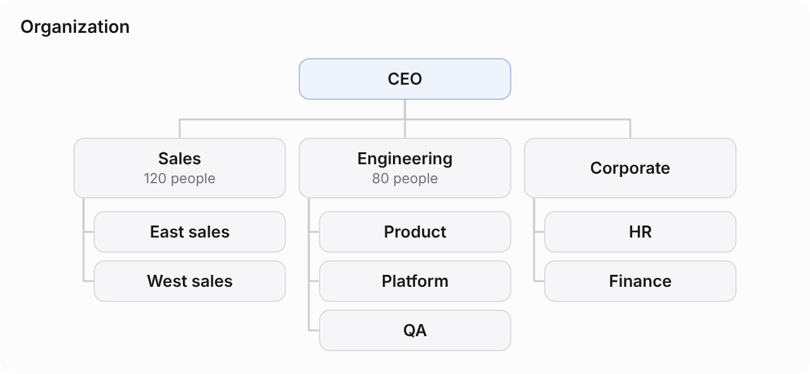

````md
```ui
tree Organization
- CEO
  - Sales: 120 people
    - East sales
    - West sales
  - Engineering: 80 people
    - Product
    - Platform
    - QA
  - Corporate
    - HR
    - Finance
```
````

### `cards`

Cards for key points, features and options. Use `stat` to make numbers big.

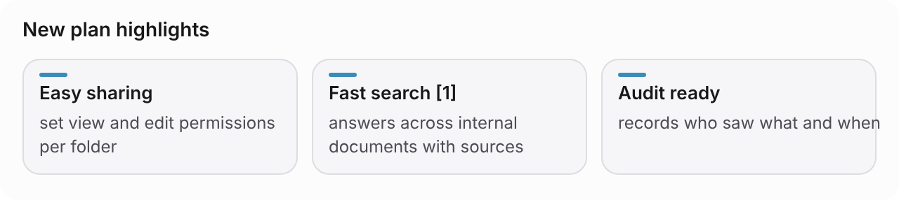

````md
```ui
cards New plan highlights
- Easy sharing: set view and edit permissions per folder
- Fast search: answers across internal documents with sources [1]
- Audit ready: records who saw what and when
```
````

### `progress`

Progress toward targets. 100% or more changes color; percentages are computed.

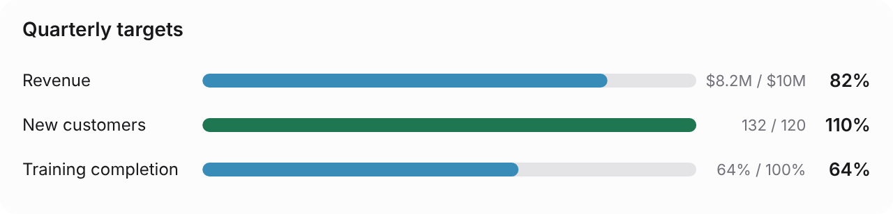

````md
```ui
progress Quarterly targets
Item | Actual | Target
Revenue | $8.2M | $10M
New customers | 132 | 120
Training completion: 64%
```
````

### `funnel`

Funnel for counts that shrink stage by stage (hiring, sales, checkout). Stage-to-stage rates are computed.

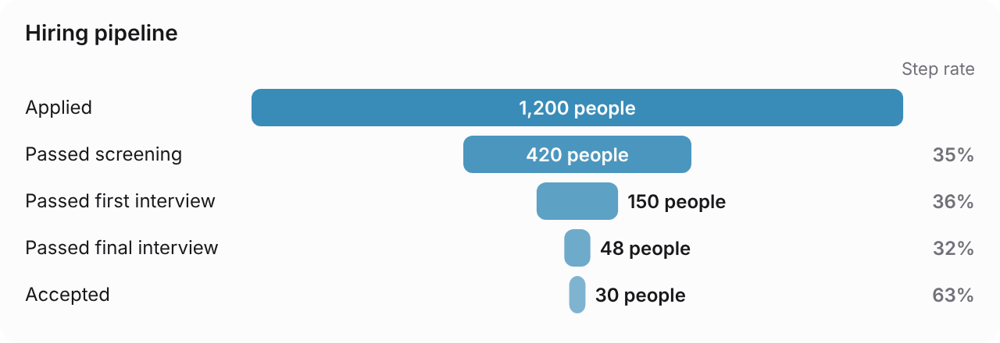

````md
```ui
funnel Hiring pipeline
unit: people
Applied | 1200
Passed screening | 420
Passed first interview | 150
Passed final interview | 48
Accepted | 30
```
````

### `quadrant`

Two-axis positioning (2×2) for priorities and positioning maps. Positions are 0–100; quadrant names are optional.

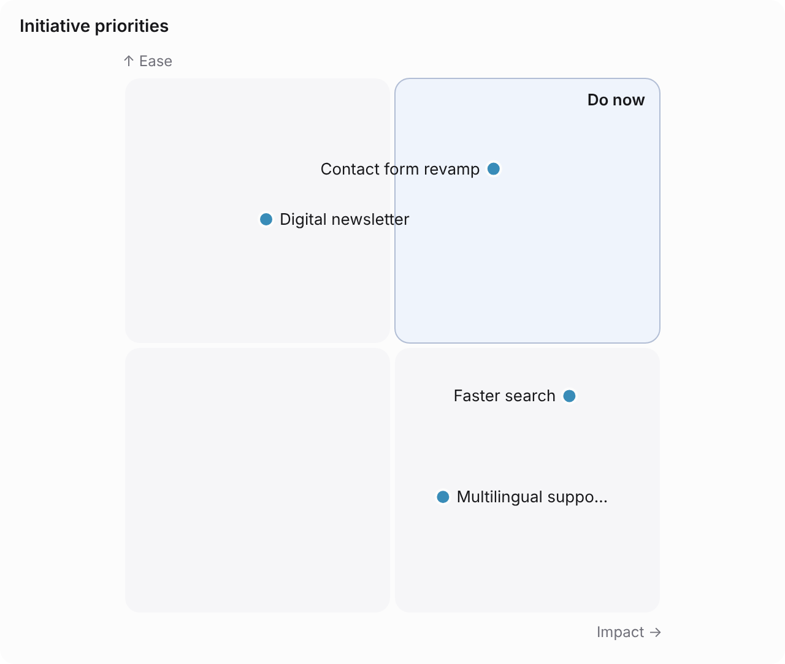

````md
```ui
quadrant Initiative priorities
x: Impact
y: Ease
右上: Do now
Contact form revamp | 70 | 85
Faster search | 85 | 40
Multilingual support | 60 | 20
Digital newsletter | 25 | 75
```
````

### `gantt`

Schedule bars. A single date becomes a milestone; ticks switch between months and weeks by span.

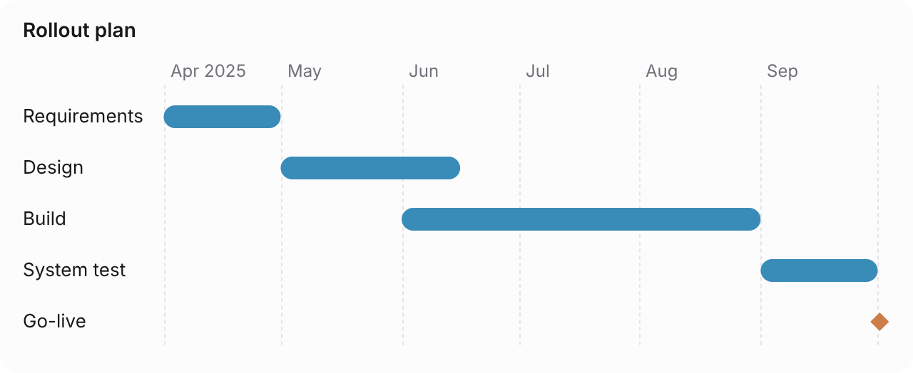

````md
```ui
gantt Rollout plan
Task | Start | End
Requirements | 2025/4/1 | 2025/4/30
Design | 5/1 | 6/15
Build | 6/1 | 8/31
System test | 9/1 | 9/30
Go-live | 10/1
```
````

### `calc`

Interactive calculator (stage 2). Sliders, steppers, choices and toggles feed formulas that Yui parses itself — no JavaScript is executed. React renders real controls; SVG export shows the current state. See [docs/calc.md](docs/calc.md).

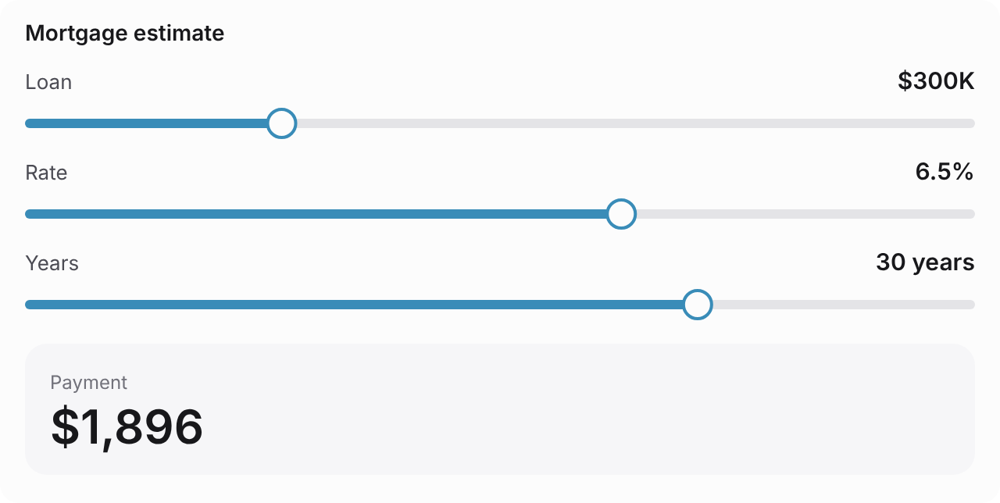

````md
```ui
calc Mortgage estimate
Loan = slider 50..1000 step 5 initial 300 $K
Rate = slider 0.5..10 step 0.05 initial 6.5 %
Years = slider 5..40 initial 30 years
MonthlyRate = Rate / 100 / 12
Payment = Loan * 1000 * MonthlyRate / (1 - (1 + MonthlyRate) ^ -(Years * 12)) $
hide: MonthlyRate
```
````


Bar charts with many rows turn horizontal, flowcharts mark branches as diamonds and route loops around the side, and every figure re-lays out to its width and follows light/dark mode. Full notation: [docs/spec.md](docs/spec.md) (Japanese). All kinds with when to use each, syntax, options and limits: [docs/kinds.md](docs/kinds.md) (Japanese).

## Usage

```tsx
// React — e.g. replace code blocks in react-markdown
import { YuiBlock, isYuiLanguage } from "@imanect/yui/react";

const code = ({ className, children }) =>
  isYuiLanguage(className)
    ? <YuiBlock source={String(children)} streaming={isStreaming} />
    : <code className={className}>{children}</code>;
```

```ts
// SVG — same result in the browser and on the server
import { parseBlock, toText } from "@imanect/yui";
import { renderSVG } from "@imanect/yui/svg";

const { figure } = parseBlock(source, { final: true });
renderSVG(figure);                                 // screens: CSS variables, follows light/dark, fluid width
renderSVG(figure, { theme: "light", width: 720 }); // export: colors and size baked in
toText(figure);                                    // plain-Markdown fallback (tables / lists)
```

```ts
// Export — copy as an image, or save as SVG / PNG (browser)
import { copyFigure, downloadFigure } from "@imanect/yui/export";

button.onclick = () => copyFigure(figure);         // PNG + HTML (image and data table) + text + Yui source
downloadFigure(figure, "png", { scale: 2 });       // or "svg"; colors baked in (theme: "light" by default)
```

`copyFigure` puts several formats on the clipboard at once, so Word, Google Docs, Gmail and Notion get an image, Slack and plain editors get a Markdown table, and Yui-aware apps get the editable source back. Call it inside a click handler (Safari only allows clipboard writes there).

One layout drives both SVG and React output, so exports look exactly like the screen. On screen, charts show values on hover (or with arrow keys) and highlight the category; flowcharts highlight the hovered box and its connections. The default look is quiet — outlined cards, dashed grid lines, muted seasonal hues — and the palette is validated for color-vision deficiencies in both light and dark. Dark mode follows `<html class="dark">` or `data-theme`, then the OS. Override anything with CSS variables (`--yui-s1` … `--yui-s8`, `--yui-ink`, `--yui-font`, …).

## Building screens with drag and drop

`app` screens (inputs and buttons) can be built without writing the syntax. A checker points at the exact input or setting that would change on save or that targets an unavailable workflow. Design: [docs/editor.md](docs/editor.md) (Japanese).

```tsx
import { toSource } from "@imanect/yui";
import { checkEditable, hasErrors } from "@imanect/yui/editor";
import { AppEditor } from "@imanect/yui/editor/react";

const r = checkEditable(source); // refuses sources with unreadable lines
if (r.ok) setFigure(r.figure);
// workflows is the closed set of targets; without it no workflow can be chosen
<AppEditor figure={figure} onChange={setFigure} workflows={workflows} onProblems={(p) => setCanSave(!hasErrors(p))} />;
const saved = toSource(figure);
```

## Does it work with small models?

We compared Yui against a JSON tool-call UI spec on Gemma 4 31B (141 tasks): Yui reached 92–99% versus 72–91%, with a quarter to a third of the tokens and half the latency. Flowcharts and architecture diagrams, which the JSON approach could barely produce, came out right 70–80% of the time. Details (Japanese): [docs/eval-results-2026-10-12-gemma.md](docs/eval-results-2026-10-12-gemma.md).

## Repository

| Path | What |
|---|---|
| `packages/core` | `@imanect/yui`: parser, IR, text fallback; `/svg` renderer; `/react` components |
| `eval` | Harness that measures how well models write Yui (tasks, scoring, runs, reports) |
| `scripts` | Rendering gallery and README images |
| `docs` | Spec, export design, evaluation plan and results (Japanese) |

```bash
pnpm install
pnpm test
pnpm typecheck
pnpm eval truncation        # streaming robustness check (no model needed)
pnpm tsx scripts/readme-images.ts
```

Pushing a `v*` tag makes GitHub Actions stage the release on npm (npm Trusted Publishing; no tokens in the repo); a maintainer then approves it with 2FA.

## License

Licensed under either of [MIT](LICENSE-MIT) or [Apache-2.0](LICENSE-APACHE) at your option. Copyright (c) 2026 Imanect Labs.
