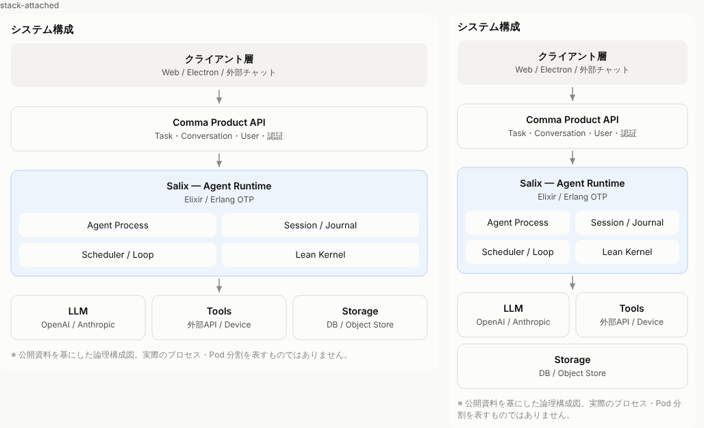
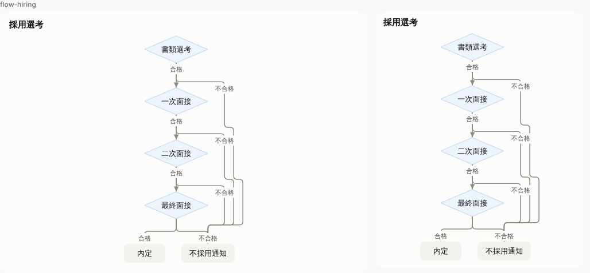
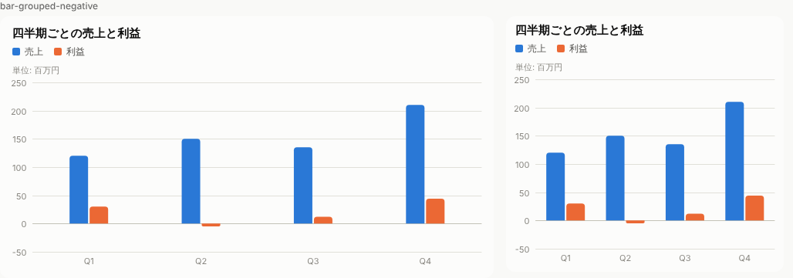
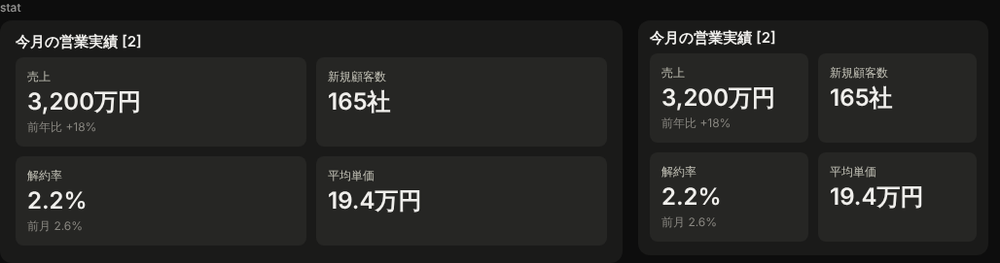

# Yui（結）

文章と UI を結ぶ。Markdown の中に ` ```ui ` ブロックで図を書くための、小さな記法とレンダラー。
チャットの回答やノートに、Markdown レンダラーと同じ感覚で組み込める Intelligent UI を目指します。

````
```ui
bar 月別売上 [1]
unit: 万円
月 | 売上 | 利益
1月 | 120 | 30
2月 | 150 | △10
```
````

- **LLM にはデータだけを書かせる。** 配置・配色・目盛りはレンダラーが決める。小さなモデルでも数行の説明で書ける。
- **モデルが書き慣れた形を受け付ける。** Markdown の表・箇条書き・Mermaid 風の矢印をそのまま読む。
- **生成途中から描ける。** 1 行ずつ確定して描画し、途中で誤った値を見せない。
- **どんなテキストでも安全。** HTML・URL・スクリプトを持たない。

状態: パーサ・SVG レンダラー・React 部品まで。npm: [`@imanect/yui`](https://www.npmjs.com/package/@imanect/yui)。






（左は幅 640px、右は 360px。描画は幅に合わせて組み直す）

## 図の種類

| 種類 | 例 |
|---|---|
| `bar` / `line` | `月 \| 売上` の列名の行のあとに `1月 \| 120` |
| `stat` | `売上 \| 3,200万円 \| 前年比 +18%` |
| `flow` | `申請 -> 課長承認 -差戻し-> 申請` |
| `stack` | `- API サーバ: Node.js` と、字下げした `  - 認証` |

詳細は [docs/spec.md](docs/spec.md)。

## 構成

| パス | 内容 |
|---|---|
| `packages/core` | パーサ・中間表現・テキスト化（`@imanect/yui`）、SVG レンダラー（`/svg`）、React 部品（`/react`） |
| `scripts/gallery.ts` | 描画の確認用ギャラリー（`pnpm tsx scripts/gallery.ts <出力先>`） |
| `eval` | 小さなモデルでの書きやすさの評価（課題・採点・実行・レポート） |
| `docs/spec.md` | 記法仕様 |
| `docs/export.md` | コピー・書き出しの設計 |
| `docs/eval-plan.md` | 評価計画（事前登録の採用基準） |

## 使い方

```tsx
// React（react-markdown のコードブロックを差し替える例）
import { YuiBlock, isYuiLanguage } from "@imanect/yui/react";

const code = ({ className, children }) =>
  isYuiLanguage(className) ? <YuiBlock source={String(children)} streaming={isStreaming} /> : <code className={className}>{children}</code>;
```

```ts
// SVG（ブラウザでもサーバーでも同じ結果）
import { parseBlock, toText } from "@imanect/yui";
import { renderSVG } from "@imanect/yui/svg";

const { figure } = parseBlock(source, { final: true });
renderSVG(figure);                                 // 画面用: CSS 変数で明暗に追従、幅は親に合わせる
renderSVG(figure, { theme: "light", width: 720 }); // 書き出し用: 色と寸法を焼き込む
toText(figure);                                    // Yui 非対応の場所向けの表・箇条書き
```

描画は 1 本のレイアウトから SVG と React の両方を作るので、画面と書き出しの見た目がずれない。配色は色覚多様性に配慮して検証済みの既定パレット（明暗それぞれ）で、`--yui-s1`〜`--yui-s8`・`--yui-ink` などの CSS 変数で差し替えられる。

## 開発

```bash
pnpm install
pnpm test              # vitest
pnpm typecheck
pnpm eval truncation   # 生成途中で切れたときの検証
pnpm eval run --mock --seeds 1
```

評価の実行方法は [docs/eval-plan.md](docs/eval-plan.md) §8。Gemma 4 31B での結果は [docs/eval-results-2026-10-12-gemma.md](docs/eval-results-2026-10-12-gemma.md)。実モデルの代わりに Claude のサブエージェントで回した予備評価の結果は [eval/pilot/2026-10-11-claude/report.md](eval/pilot/2026-10-11-claude/report.md)（§10）。

## npm パッケージ

`@imanect/yui`（`packages/core`）。描画や Markdown プラグインは `@imanect/yui/react` などのサブパスで足していく。

公開は `v0.1.0` のようなタグの push で GitHub Actions（`.github/workflows/publish.yml`）が行う。npm の Trusted Publishing を使うため、npmjs.com 側でこのリポジトリとワークフローを登録しておく。

## ライセンス

[MIT](LICENSE-MIT) または [Apache-2.0](LICENSE-APACHE) のどちらかを選んで使える（`MIT OR Apache-2.0`）。Copyright (c) 2026 Imanect Labs.
