# 図の種類の一覧

<!-- scripts/kinds-doc.ts が生成する。直接編集しない（pnpm docs:kinds で作り直す）。 -->

Yui が描ける図は 21 種類。どれも Markdown の ` ```ui ` ブロックに、1 行目「種類 タイトル」、2 行目以降にデータを書く。
配置・色・目盛りはレンダラーが決めるので、記法に見た目の指定は無い。共通の書き方（ブロック・1 行目・引用番号・数値の読み方）は [spec.md](spec.md) の §2〜§4・§6 を参照。

## 早見表

| 種類 | 名前 | 用途 | 別名 |
|---|---|---|---|
| [`bar`](#bar-棒グラフ) | 棒グラフ | 項目や時期ごとの数値の比較 | `bars` `column` `棒` `棒グラフ` |
| [`line`](#line-折れ線グラフ) | 折れ線グラフ | 時期ごとの推移 | `折れ線` `折れ線グラフ` |
| [`pie`](#pie-円グラフドーナツ) | 円グラフ（ドーナツ） | 全体に占める割合・内訳 | `donut` `円` `円グラフ` `ドーナツ` |
| [`scatter`](#scatter-散布図) | 散布図 | 2 つの量の関係・ばらつき | `散布図` |
| [`stat`](#stat-数値カード) | 数値カード | 主な指標をいくつか大きく並べる（件数・率・金額など） | `stats` `kpi` |
| [`progress`](#progress-進捗) | 進捗 | 目標に対してどこまで進んだか | `進捗` `達成率` |
| [`funnel`](#funnel-ファネル) | ファネル | 段階ごとに減っていく数（選考・商談・購入まで） | `ファネル` `歩留まり` |
| [`flow`](#flow-流れ図) | 流れ図 | 承認・処理の流れ | `flowchart` `フロー` |
| [`steps`](#steps-手順) | 手順 | 分岐の無い手順・段取り | `step` `手順` `ステップ` |
| [`timeline`](#timeline-年表) | 年表 | 沿革・予定・時刻順の出来事 | `年表` `沿革` `タイムライン` |
| [`gantt`](#gantt-工程表) | 工程表 | いつからいつまでの作業か | `ガント` `ガントチャート` `工程表` |
| [`stack`](#stack-構成図) | 構成図 | システム構成・アーキテクチャなど、層の積み重ね | `layers` `arch` `構成` `構成図` |
| [`tree`](#tree-階層) | 階層 | 組織図・分類・目次・フォルダ構成など、親子の階層 | `ツリー` `階層` `組織図` |
| [`quadrant`](#quadrant-4象限) | 4象限 | 2 つの軸での位置づけ（優先度・ポジショニング） | `matrix` `4象限` `四象限` `マトリクス` |
| [`cards`](#cards-カード) | カード | 要点・特徴・選択肢・料金プランを並べて見せる | `card` `カード` `要点` |
| [`compare`](#compare-比較表) | 比較表 | 製品・プラン・案を項目ごとに比べる | `comparison` `比較` `比較表` |
| [`proscons`](#proscons-メリットデメリット) | メリット・デメリット | 案・選択の良い点と悪い点を左右に並べる | `pros-cons` `pros_cons` `メリット・デメリット` `メリットデメリット` `長所短所` |
| [`swot`](#swot-swot) | SWOT | 強み・弱み・機会・脅威の 4 つに分けた整理 |  |
| [`checklist`](#checklist-チェックリスト) | チェックリスト | 確認事項・タスクの済・未・進行中と、完了の数 | `check` `todo` `チェックリスト` `確認事項` |
| [`calc`](#calc-計算機) | 計算機 | 利用者が値を動かすと結果が変わる計算（ローン・料金の試算・割り勘） | `計算` `試算` `calculator` |
| [`app`](#app-アプリ入力と実行) | アプリ（入力と実行） | 入力部品とボタンを並べ、押すとホストがその値でワークフローを起動する（Yui は実行しない） | `form` `アプリ` `フォーム` |

1 行目の種類は、表の種類名か別名のどれで書いてもよい（`棒グラフ 売上`、`ui bar` のように情報文字列に書いてもよい）。

## グラフ

### bar 棒グラフ

項目や時期ごとの数値の比較。系列が複数なら並べる・積み上げる。

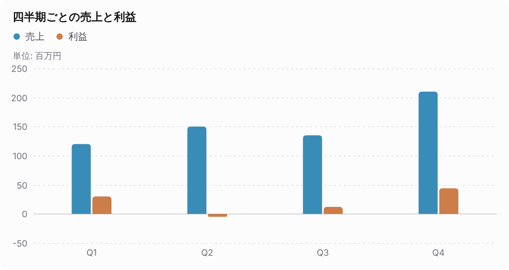

````md
```ui
bar 四半期ごとの売上と利益
unit: 百万円
四半期 | 売上 | 利益
Q1 | 120 | 30
Q2 | 150 | -5
Q3 | 135 | 12
Q4 | 210 | 44
```
````

**書き方**

- 2 行目に列名、以降「ラベル | 数値 | 数値…」
- GFM の表、`1月: 120` の形も受ける
- 行が多い・項目名が長いと横向きになる

**オプション行**: `unit:` 単位、`stacked: true` 積み上げ、`horizontal: true` 横向き、`note:` 注記、`src:` データ参照（ホストが解決）

**上限**: 500 行 × 13 列

**別名**: `bars` `column` `棒` `棒グラフ`

**使い分け**: 全体に占める割合は pie、時間の流れに沿った推移は line。

**仕様**: [spec.md §5.1 bar / line](spec.md#51-bar--line)

### line 折れ線グラフ

時期ごとの推移。系列が 2 つ以上なら凡例が付く。

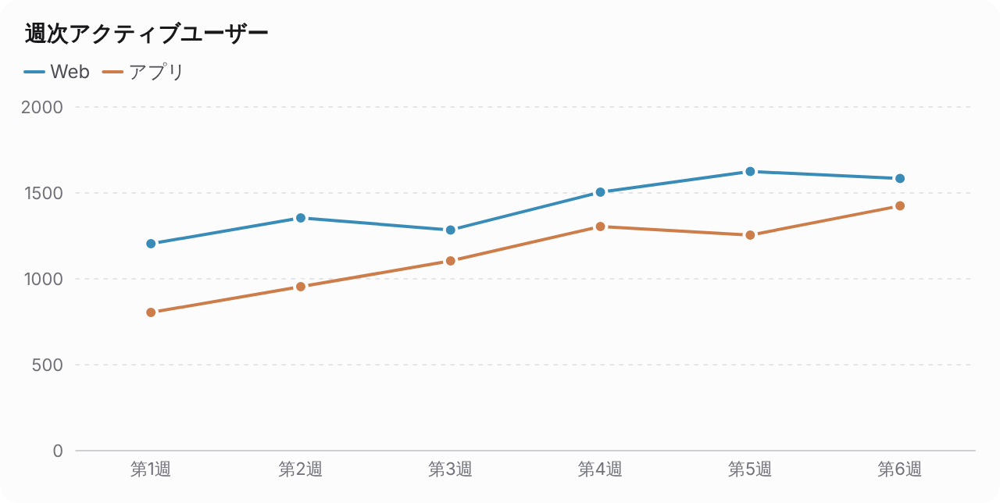

````md
```ui
line 週次アクティブユーザー
週 | Web | アプリ
第1週 | 1200 | 800
第2週 | 1350 | 950
第3週 | 1280 | 1100
第4週 | 1500 | 1300
第5週 | 1620 | 1250
第6週 | 1580 | 1420
```
````

**書き方**

- 書き方は bar と同じ

**オプション行**: `unit:` 単位、`stacked: true` 積み上げ（面グラフの代わり）、`note:` 注記、`src:` データ参照（ホストが解決）

**上限**: 500 行 × 13 列

**別名**: `折れ線` `折れ線グラフ`

**使い分け**: 項目どうしの比較は bar。

**仕様**: [spec.md §5.1 bar / line](spec.md#51-bar--line)

### pie 円グラフ（ドーナツ）

全体に占める割合・内訳。割合はレンダラーが計算する。

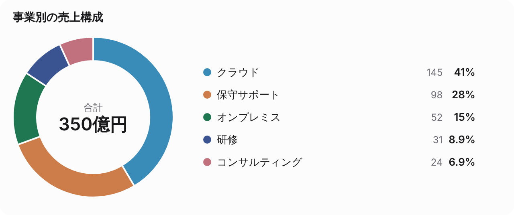

````md
```ui
pie 事業別の売上構成
unit: 億円
事業 | 売上
クラウド | 145
保守サポート | 98
オンプレミス | 52
研修 | 31
コンサルティング | 24
```
````

**書き方**

- 書き方は bar と同じで、数値の列は 1 つ
- 値は 0 以上。扇は書いた順に並ぶ

**オプション行**: `unit:` 単位、`note:` 注記、`src:` データ参照（ホストが解決）

**上限**: 12 項目（9 項目目以降は灰色）

**別名**: `donut` `円` `円グラフ` `ドーナツ`

**使い分け**: 項目が多い・値どうしを比べたいなら bar。

**仕様**: [spec.md §5.5 pie](spec.md#55-pie)

### scatter 散布図

2 つの量の関係・ばらつき。

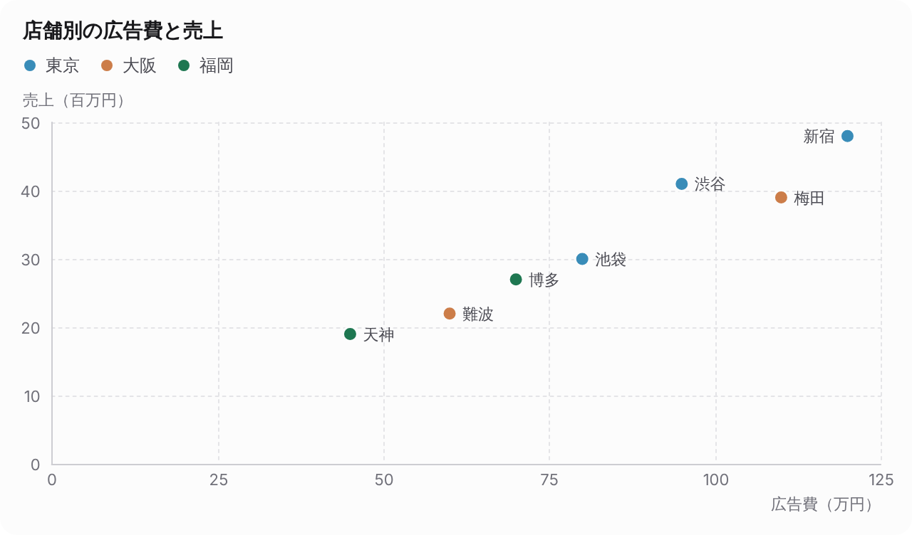

````md
```ui
scatter 店舗別の広告費と売上
店舗 | 広告費（万円） | 売上（百万円） | 地域
新宿 | 120 | 48 | 東京
渋谷 | 95 | 41 | 東京
池袋 | 80 | 30 | 東京
梅田 | 110 | 39 | 大阪
難波 | 60 | 22 | 大阪
天神 | 45 | 19 | 福岡
博多 | 70 | 27 | 福岡
```
````

**書き方**

- 2 行目に「ラベル | 横軸の名前 | 縦軸の名前」、以降「名前 | 数値 | 数値」
- 4 列目に名前があれば、まとまりごとに色分け
- 単位は軸の名前に括弧で書く

**オプション行**: `note:` 注記、`src:` データ参照（ホストが解決）

**上限**: 200 点（15 点までは名前を添える）

**別名**: `散布図`

**使い分け**: 0〜100 の評価で 2×2 に位置づけるなら quadrant。

**仕様**: [spec.md §5.6 scatter](spec.md#56-scatter)

## 数値

### stat 数値カード

主な指標をいくつか大きく並べる（件数・率・金額など）。

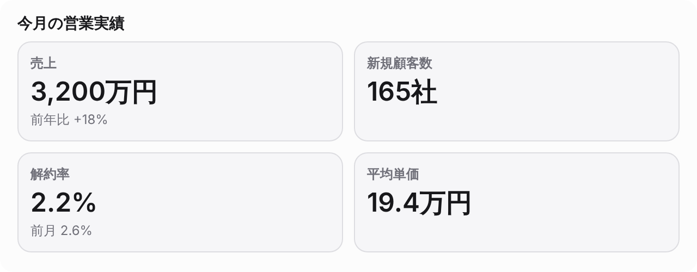

````md
```ui
stat 今月の営業実績
売上 | 3,200万円 | 前年比 +18%
新規顧客数 | 165社
解約率 | 2.2% | 前月 2.6%
平均単価 | 19.4万円
```
````

**書き方**

- 「項目 | 値 | 補足（任意）」または「項目: 値」
- 値は書かれた表記のまま出す

**オプション行**: `note:` 注記、`src:` データ参照（ホストが解決）

**上限**: 24 項目

**別名**: `stats` `kpi`

**使い分け**: 目標に対する進み具合は progress、段階ごとに減る数は funnel、文章の要点は cards。

**仕様**: [spec.md §5.2 stat](spec.md#52-stat)

### progress 進捗

目標に対してどこまで進んだか。達成率はレンダラーが計算する。

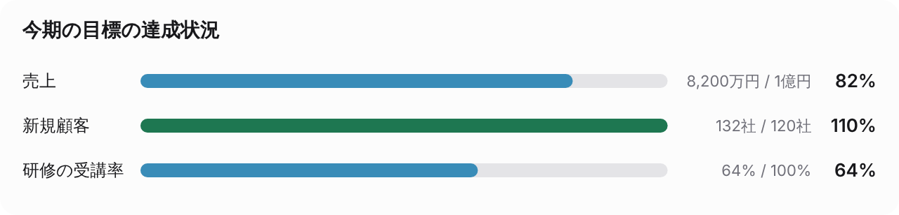

````md
```ui
progress 今期の目標の達成状況
項目 | 実績 | 目標
売上 | 8,200万円 | 1億円
新規顧客 | 132社 | 120社
研修の受講率: 64%
```
````

**書き方**

- 「項目 | 実績 | 目標」、「項目 | 実績 / 目標」、「項目: 64%」（% だけなら目標は 100%）
- 100% 以上は色が変わる

**オプション行**: `note:` 注記、`src:` データ参照（ホストが解決）

**上限**: 20 項目

**別名**: `進捗` `達成率`

**使い分け**: 値が小さいほど良い指標（解約率など）は表せないので bar か stat。

**仕様**: [spec.md §5.11 progress](spec.md#511-progress)

### funnel ファネル

段階ごとに減っていく数（選考・商談・購入まで）。前の段階からの割合を計算する。

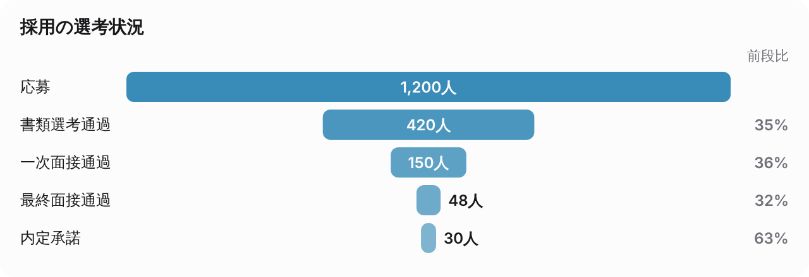

````md
```ui
funnel 採用の選考状況
unit: 人
応募 | 1200
書類選考通過 | 420
一次面接通過 | 150
最終面接通過 | 48
内定承諾 | 30
```
````

**書き方**

- 「段階 | 数」または「段階: 数」を最初の段階から順に

**オプション行**: `unit:` 単位、`note:` 注記、`src:` データ参照（ホストが解決）

**上限**: 10 段階

**別名**: `ファネル` `歩留まり`

**使い分け**: 段階が順につながらない指標の一覧は stat。

**仕様**: [spec.md §5.12 funnel](spec.md#512-funnel)

## 流れ・手順・時間

### flow 流れ図

承認・処理の流れ。分岐・差戻し・繰り返しを含められる。

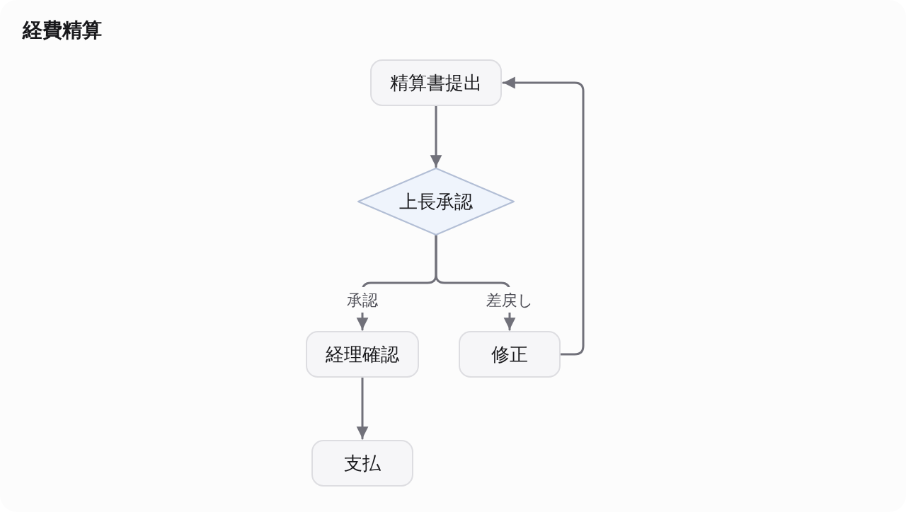

````md
```ui
flow 経費精算
精算書提出 -> 上長承認
上長承認 -承認-> 経理確認 -> 支払
上長承認 -差戻し-> 修正
修正 -> 精算書提出
```
````

**書き方**

- 「A -> B -> C」、条件は「A -ラベル-> B」
- 同じ名前は同じ箱。分岐はひし形、ループは脇を回る

**オプション行**: `dir: LR` 横向き、`note:` 注記、`src:` データ参照（ホストが解決）

**上限**: 60 ノード、100 辺

**別名**: `flowchart` `フロー`

**使い分け**: 分岐の無い手順は steps、システムの構成は stack。

**仕様**: [spec.md §5.3 flow](spec.md#53-flow)

### steps 手順

分岐の無い手順・段取り。番号は書いた順に振る。


````md
```ui
steps 経費精算の手順
1. 申請: 領収書を添えて精算システムに入力する
2. 上長の承認: 目的と金額を確認する
3. 経理の確認: 勘定科目と証憑を確認する
4. 支払: 翌月の給与と一緒に振り込む
```
````

**書き方**

- 「1. 見出し: 説明」、「見出し | 説明」
- 字下げした行は直前の手順の説明の段落（1 行 1 段落）

**オプション行**: `note:` 注記、`src:` データ参照（ホストが解決）

**上限**: 15 手順

**別名**: `step` `手順` `ステップ`

**使い分け**: 分岐・差戻しがあれば flow。

**仕様**: [spec.md §5.8 steps](spec.md#58-steps)

### timeline 年表

沿革・予定・時刻順の出来事。書いた順に並べる。


````md
```ui
timeline 会社の沿革
- 2015年4月: 創業（東京・渋谷）
- 2017年10月: 初の製品を発売
- 2019年6月: 大阪支社を開設 [1]
- 2021年1月: 導入企業 100 社を突破
  クラウド版の提供を開始
- 2024年4月: 東証グロース市場に上場
```
````

**書き方**

- 「- 時期: 出来事」、「時期 | 出来事 | 補足」、「10:00 出来事」
- 字下げした行は直前の出来事の補足の段落

**オプション行**: `note:` 注記、`src:` データ参照（ホストが解決）

**上限**: 40 出来事

**別名**: `年表` `沿革` `タイムライン`

**使い分け**: いつからいつまでの期間があるなら gantt。

**仕様**: [spec.md §5.7 timeline](spec.md#57-timeline)

### gantt 工程表

いつからいつまでの作業か。1 日だけのものはマイルストーン。

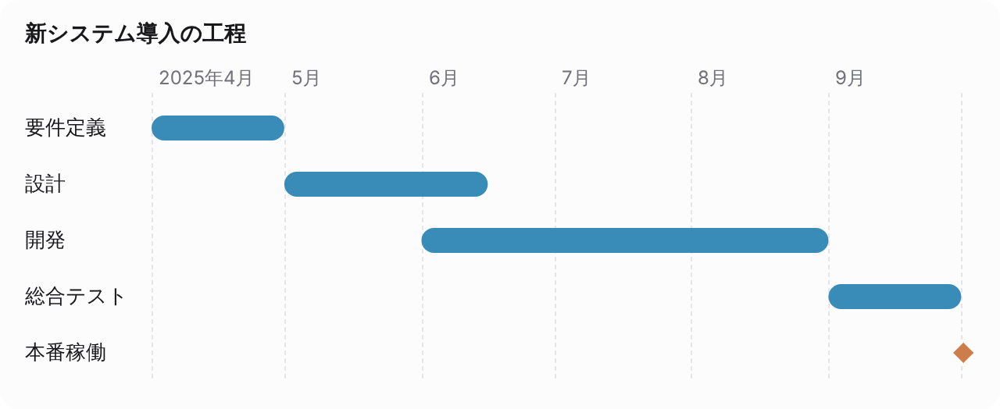

````md
```ui
gantt 新システム導入の工程
タスク | 開始 | 終了
要件定義 | 2025/4/1 | 2025/4/30
設計 | 5/1 | 6/15
開発 | 6/1 | 8/31
総合テスト | 9/1 | 9/30
本番稼働 | 10/1
```
````

**書き方**

- 「タスク | 開始 | 終了」、「タスク: 開始 〜 終了」
- 日付は `2025/4/1`・`4/1`・`2025年4月`・`4月`。年は直前の行から引き継ぐ

**オプション行**: `note:` 注記、`src:` データ参照（ホストが解決）

**上限**: 30 タスク

**別名**: `ガント` `ガントチャート` `工程表`

**使い分け**: 出来事の時期だけなら timeline。

**仕様**: [spec.md §5.14 gantt](spec.md#514-gantt)

## 構造・整理

### stack 構成図

システム構成・アーキテクチャなど、層の積み重ね。層の間の矢印は自動で引く。

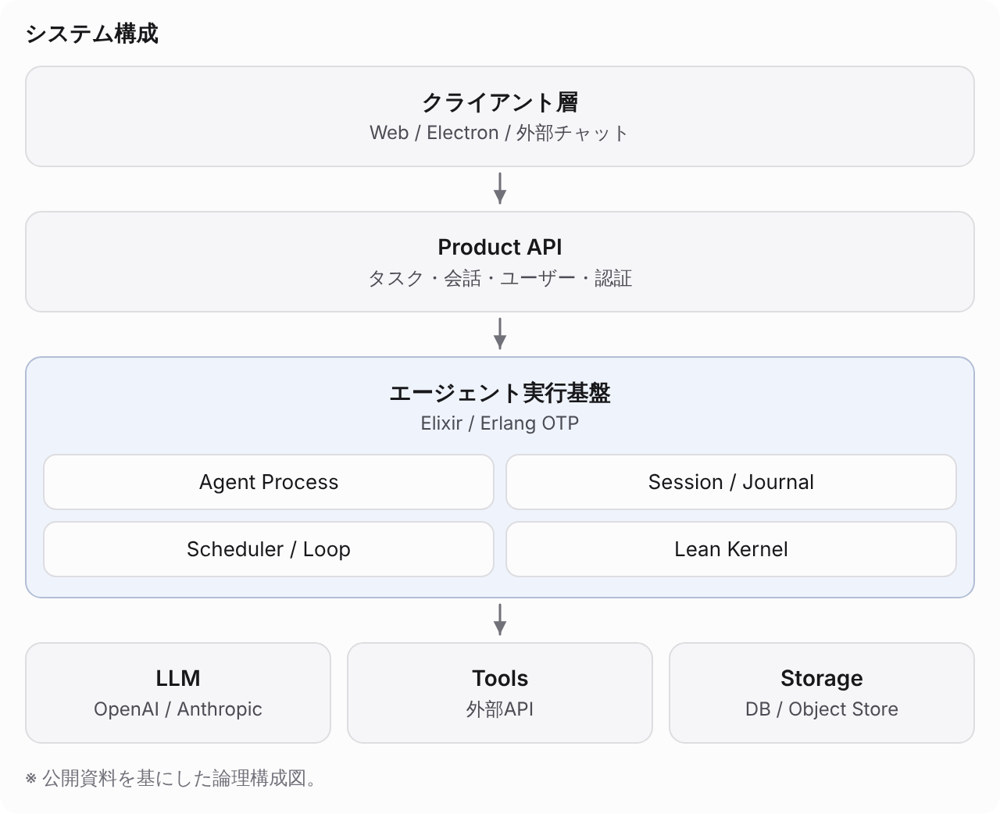

````md
```ui
stack システム構成
- クライアント層: Web / Electron / 外部チャット
- Product API: タスク・会話・ユーザー・認証
- エージェント実行基盤: Elixir / Erlang OTP
  - Agent Process
  - Session / Journal
  - Scheduler / Loop
  - Lean Kernel
- LLM: OpenAI / Anthropic | Tools: 外部API | Storage: DB / Object Store
note: 公開資料を基にした論理構成図。
```
````

**書き方**

- 上の層から「- 名前: 説明」
- 層の中の要素は字下げして「  - 名前」
- 同じ段に横に並べるものは「名前 | 名前」

**オプション行**: `note:` 注記、`src:` データ参照（ホストが解決）

**上限**: 12 層、横並び 8、層の中の要素 16

**別名**: `layers` `arch` `構成` `構成図`

**使い分け**: 組織図・分類など親子の階層は tree、処理の順序は flow。

**仕様**: [spec.md §5.4 stack](spec.md#54-stack)

### tree 階層

組織図・分類・目次・フォルダ構成など、親子の階層。

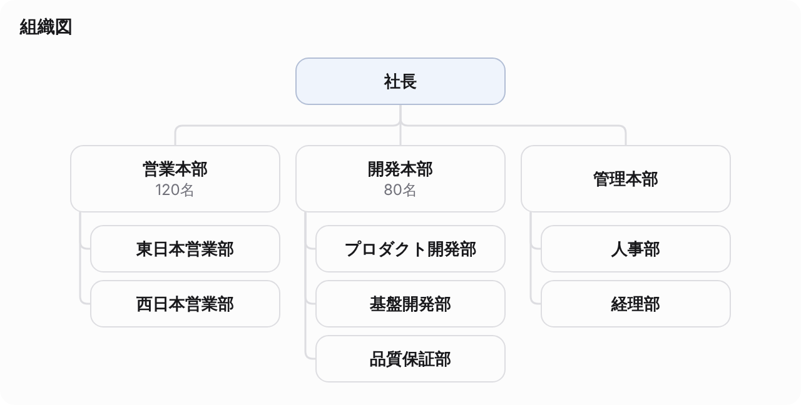

````md
```ui
tree 組織図
- 社長
  - 営業本部: 120名
    - 東日本営業部
    - 西日本営業部
  - 開発本部: 80名
    - プロダクト開発部
    - 基盤開発部
    - 品質保証部
  - 管理本部
    - 人事部
    - 経理部
```
````

**書き方**

- 字下げした箇条書き（深さは 4 段まで）
- 「名前: 説明」、1 行の中の `|` は兄弟の並び
- 幅に収まれば組織図、収まらなければ字下げの一覧で描く

**オプション行**: `note:` 注記、`src:` データ参照（ホストが解決）

**上限**: 80 項目、深さ 4

**別名**: `ツリー` `階層` `組織図`

**使い分け**: システムの層構成は stack。

**仕様**: [spec.md §5.9 tree](spec.md#59-tree)

### quadrant 4象限

2 つの軸での位置づけ（優先度・ポジショニング）。

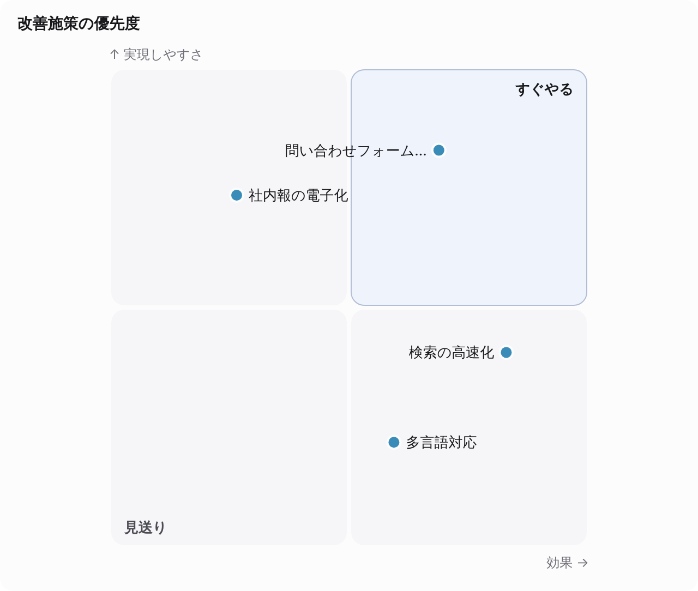

````md
```ui
quadrant 改善施策の優先度
x: 効果
y: 実現しやすさ
右上: すぐやる
左下: 見送り
問い合わせフォームの改善 | 70 | 85
検索の高速化 | 85 | 40
多言語対応 | 60 | 20
社内報の電子化 | 25 | 75
```
````

**書き方**

- `x: 横軸の名前`・`y: 縦軸の名前`
- 象限の名前は `右上: すぐやる` など（任意）
- 項目は「名前 | 横 | 縦」で、位置は 0〜100

**オプション行**: `note:` 注記、`src:` データ参照（ホストが解決）

**上限**: 30 項目

**別名**: `matrix` `4象限` `四象限` `マトリクス`

**使い分け**: 実際の数値どうしの関係は scatter。

**仕様**: [spec.md §5.13 quadrant](spec.md#513-quadrant)

### cards カード

要点・特徴・選択肢・料金プランを並べて見せる。


````md
```ui
cards 新プランの特徴
- 共有がかんたん: フォルダごとに閲覧・編集の権限を付けられます
- 検索が速い: 社内文書を横断して、根拠付きで答えます [1]
- 監査に強い: 誰がいつ何を見たかをすべて記録します
```
````

**書き方**

- 「- 見出し: 本文」、「見出し | 本文」
- 値を大きく出すなら「- 見出し | 値 | 本文」（料金・数値）
- 字下げした行は本文の段落、字下げした「- 項目」は ✓ の付いた一覧

**オプション行**: `note:` 注記、`src:` データ参照（ホストが解決）

**上限**: 12 枚、1 枚に項目 8

**別名**: `card` `カード` `要点`

**使い分け**: 数値を大きく見せるなら stat。

**仕様**: [spec.md §5.10 cards](spec.md#510-cards)

## 比較・判断

### compare 比較表

製品・プラン・案を項目ごとに比べる。✓ / ✗ / △ は印で描く。

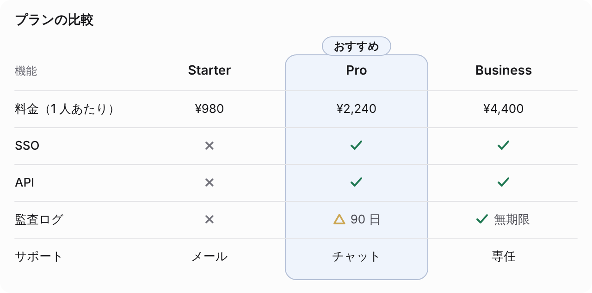

````md
```ui
compare プランの比較
推奨: Pro
機能 | Starter | Pro | Business
料金（1 人あたり） | ¥980 | ¥2,240 | ¥4,400
SSO | ✗ | ✓ | ✓
API | ✗ | ✓ | ✓
監査ログ | ✗ | △ 90 日 | ✓ 無期限
サポート | メール | チャット | 専任
```
````

**書き方**

- 1 行目に「項目 | 選択肢 | 選択肢…」、以降「項目 | セル | セル…」
- セルの `✓` `○` `あり` は ✓、`✗` `×` `-` `なし` は ✗、`△` `一部` は △。印の後ろに文字を続けてもよい

**オプション行**: `推奨: 選択肢` その列を強調する、`note:` 注記、`src:` データ参照（ホストが解決）

**上限**: 選択肢 6、30 項目

**別名**: `comparison` `比較` `比較表`

**使い分け**: 数値の大小を比べるなら bar。選択肢の要点を並べるだけなら cards。

**仕様**: [spec.md §5.16 compare](spec.md#516-compare)

### proscons メリット・デメリット

案・選択の良い点と悪い点を左右に並べる。

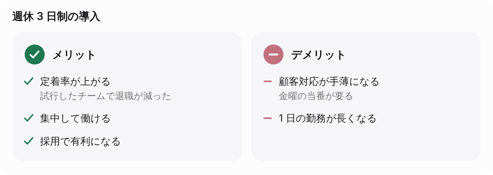

````md
```ui
proscons 週休 3 日制の導入
メリット:
- 定着率が上がる: 試行したチームで退職が減った
- 集中して働ける
- 採用で有利になる
デメリット:
- 顧客対応が手薄になる: 金曜の当番が要る
- 1 日の勤務が長くなる
```
````

**書き方**

- `メリット:` `デメリット:` の見出しの下に「- 項目: 補足」
- 見出しを書かないなら「+ 項目」（メリット）と「- 項目」（デメリット）
- 「メリット | デメリット」の 2 列の表も受ける

**オプション行**: `note:` 注記、`src:` データ参照（ホストが解決）

**上限**: それぞれ 12 項目

**別名**: `pros-cons` `pros_cons` `メリット・デメリット` `メリットデメリット` `長所短所`

**使い分け**: 複数の案を項目ごとに比べるなら compare。

**仕様**: [spec.md §5.17 proscons](spec.md#517-proscons)

### swot SWOT

強み・弱み・機会・脅威の 4 つに分けた整理。

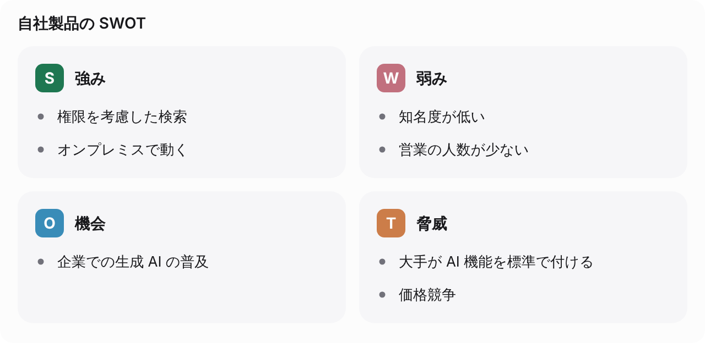

````md
```ui
swot 自社製品の SWOT
強み:
- 権限を考慮した検索
- オンプレミスで動く
弱み:
- 知名度が低い
- 営業の人数が少ない
機会:
- 企業での生成 AI の普及
脅威:
- 大手が AI 機能を標準で付ける
- 価格競争
```
````

**書き方**

- `強み:` `弱み:` `機会:` `脅威:`（`Strengths:` `S:` も可）の見出しの下に「- 項目」

**オプション行**: `note:` 注記、`src:` データ参照（ホストが解決）

**上限**: それぞれ 8 項目

**使い分け**: 2 つの軸での位置づけは quadrant。

**仕様**: [spec.md §5.18 swot](spec.md#518-swot)

### checklist チェックリスト

確認事項・タスクの済・未・進行中と、完了の数。

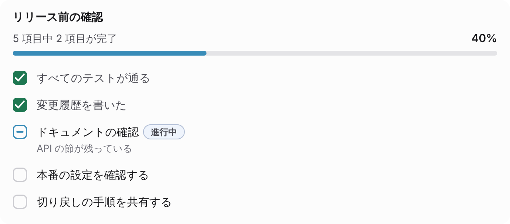

````md
```ui
checklist リリース前の確認
- [x] すべてのテストが通る
- [x] 変更履歴を書いた
- [~] ドキュメントの確認: API の節が残っている
- [ ] 本番の設定を確認する
- [ ] 切り戻しの手順を共有する
```
````

**書き方**

- 「- [x] 済んだ項目」「- [ ] 未の項目」「- [~] 進行中の項目」
- 「項目: 補足」、字下げした行は補足の段落
- 「項目 | 状態」の表（状態は 完了・未・進行中）も受ける

**オプション行**: `note:` 注記、`src:` データ参照（ホストが解決）

**上限**: 30 項目

**別名**: `check` `todo` `チェックリスト` `確認事項`

**使い分け**: 数値の目標に対する進み具合は progress、順序のある段取りは steps。

**仕様**: [spec.md §5.19 checklist](spec.md#519-checklist)

## 操作できる図

### calc 計算機

利用者が値を動かすと結果が変わる計算（ローン・料金の試算・割り勘）。式は Yui が解釈し、JavaScript は実行しない。

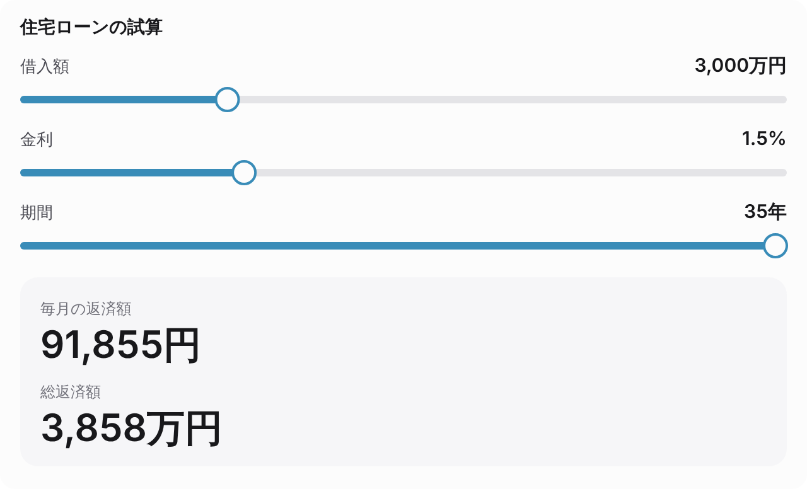

````md
```ui
calc 住宅ローンの試算
借入額 = slider 500..10000 step 100 初期 3000 万円
金利 = slider 0.1..5 step 0.05 初期 1.5 %
期間 = slider 5..35 初期 35 年
月利 = 金利 / 100 / 12
毎月の返済額 = 借入額 * 10000 * 月利 / (1 - (1 + 月利) ^ -(期間 * 12)) 円
総返済額 = 毎月の返済額 * 期間 * 12 / 10000 万円
show 毎月の返済額 | 総返済額
hide: 月利
```
````

**書き方**

- 1 行に 1 つ「名前 = 中身 単位」
- 入力: `slider 最小..最大 step 刻み 初期 値`・`count 最小..最大 初期 値`・`choice 表示名=値 | 表示名=値`・`toggle`
- 式: 前に定義した名前と数値、`+ - * / ^ ( )`、`min` `max` `round` `if(条件, 真, 偽)` など

**オプション行**: `show 名前 | 名前` 大きく出す結果、`hide: 名前, 名前` 内訳に出さない式、`round N` 表示の小数桁（式の行末）、`note:` 注記、`src:` データ参照（ホストが解決）

**上限**: 30 定義、1 式 200 文字

**別名**: `計算` `試算` `calculator`

**仕様**: [spec.md §5.15 calc](spec.md#515-calc)、[calc.md](calc.md)

### app アプリ（入力と実行）

入力部品とボタンを並べ、押すとホストがその値でワークフローを起動する（Yui は実行しない）。機能ごとに分けて並べられる。

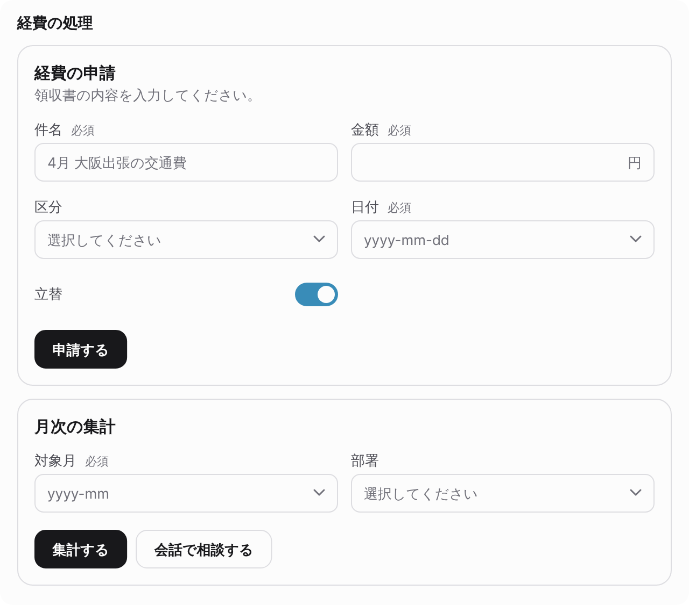

````md
```ui
app 経費の処理
## 経費の申請
> 領収書の内容を入力してください。
件名 = text 必須 例 4月 大阪出張の交通費
金額 = number 1..1000000 円 必須 as amount
区分 = choice 交通費 | 出張費 | 備品
日付 = date 必須
立替 = toggle 初期 オン
button 申請する -> workflow 経費申請

## 月次の集計
対象月 = month 必須
部署 = choice 営業 | 開発 | 管理 multi
button 集計する -> workflow 月次集計
button 会話で相談する -> chat
```
````

**書き方**

- `## 見出し` で機能を分け、`> 説明`
- 入力は「ラベル = 種類」（text・textarea・number・choice・date・month・toggle・slider・count）。`必須`・`例 …`・`初期 …`・`as キー`
- ボタンは「button ラベル -> workflow 名前」か「-> chat」

**オプション行**: `note:` 注記、`src:` データ参照（ホストが解決）

**上限**: 機能 6、入力 1 機能 20・全体 40、ボタン 1 機能 3

**別名**: `form` `アプリ` `フォーム`

**使い分け**: 画面の中で計算が完結するなら calc。

**仕様**: [spec.md §5.20 app（docs/app.md）](spec.md#520-appdocsappmd)
