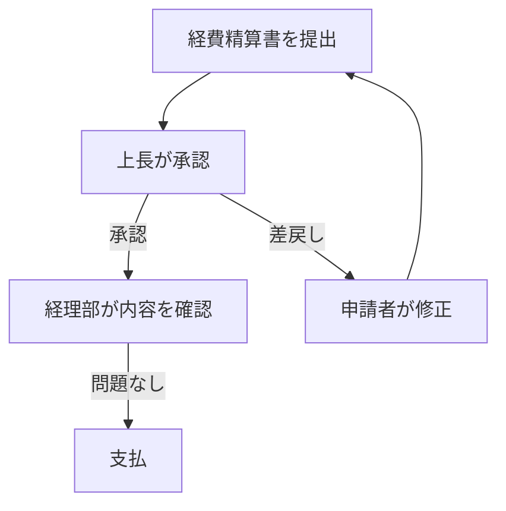
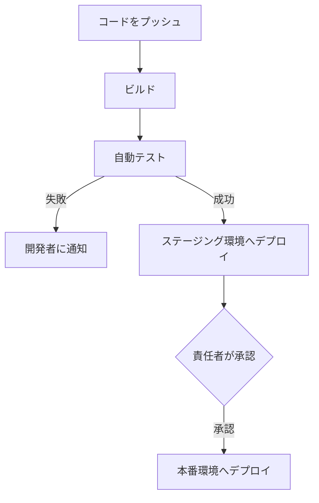
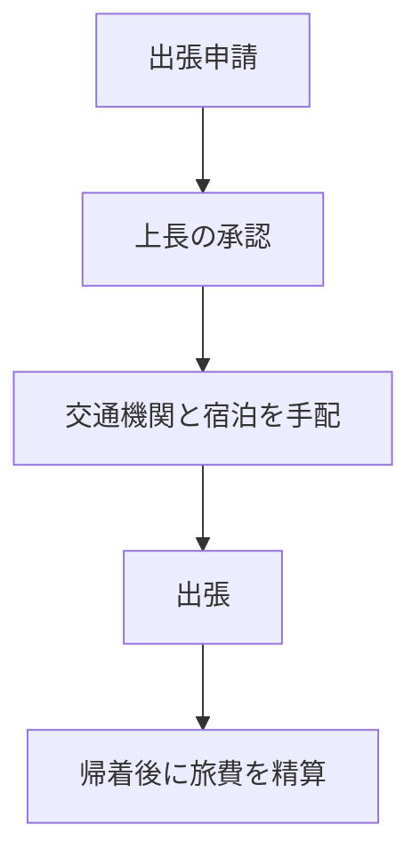
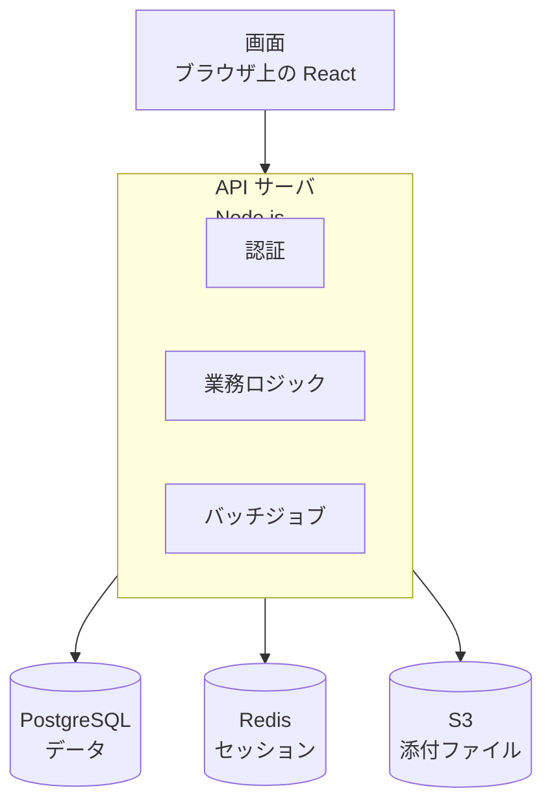
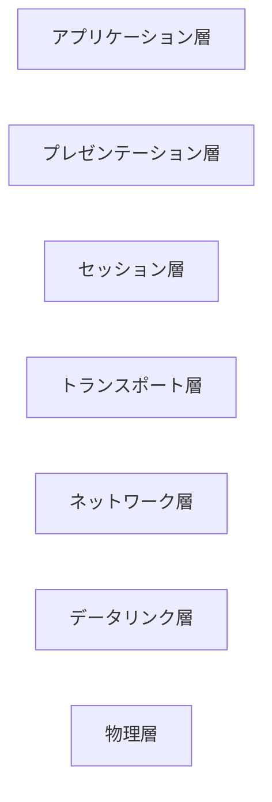
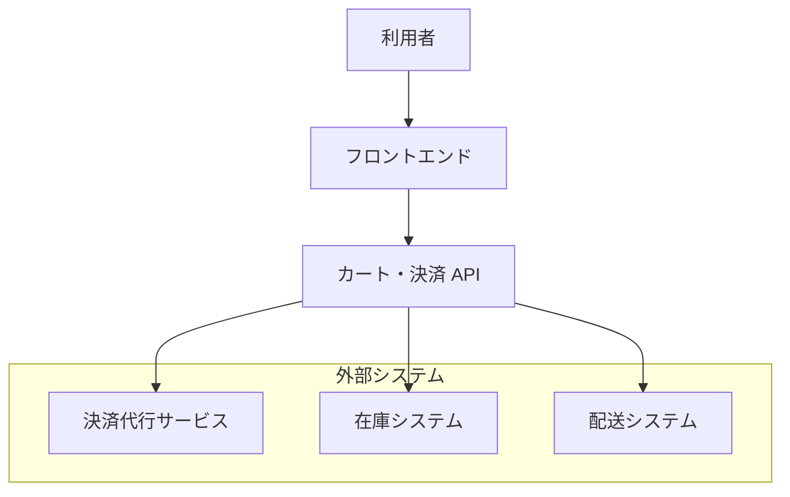

=== TASK flow-001 ===
経費精算の流れは次のとおりです。資料には経理部が問題を見つけた場合の扱いは書かれていないため、図には含めていません。

=== TASK flow-007 ===
資料に基づくデプロイの流れは次のとおりです。資料には責任者が承認しなかった場合の扱いが書かれていないため、図には含めていません。

=== TASK flow-014 ===
出張の手続きは次の流れです。資料には上長が承認しなかった場合の扱いが書かれていないため、図には含めていません。

=== TASK stack-001 ===
資料に基づく構成は次のとおりです。資料には各部品の通信の向きが細かく書かれていないため、矢印は主な通信の流れを示す目安です。

=== TASK stack-006 ===
OSI 参照モデルの7階層を上から順に示します。図は階層の並びを示すもので、データの流れは表していません。

=== TASK stack-011 ===
資料に基づく EC サイトの構成は次のとおりです。資料には連携の向きや内部の細かい構成が書かれていないため、矢印は呼び出しの流れの目安です。

