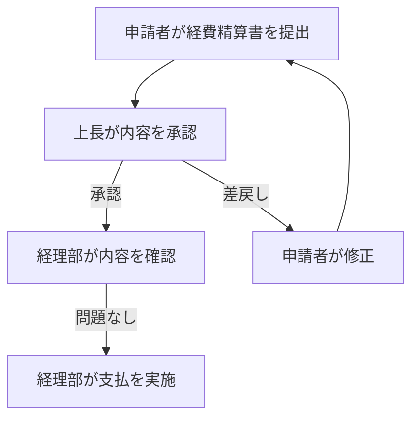
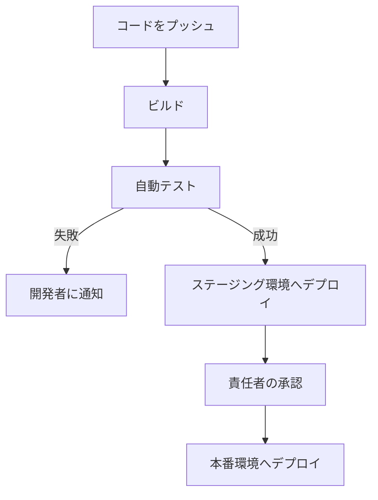
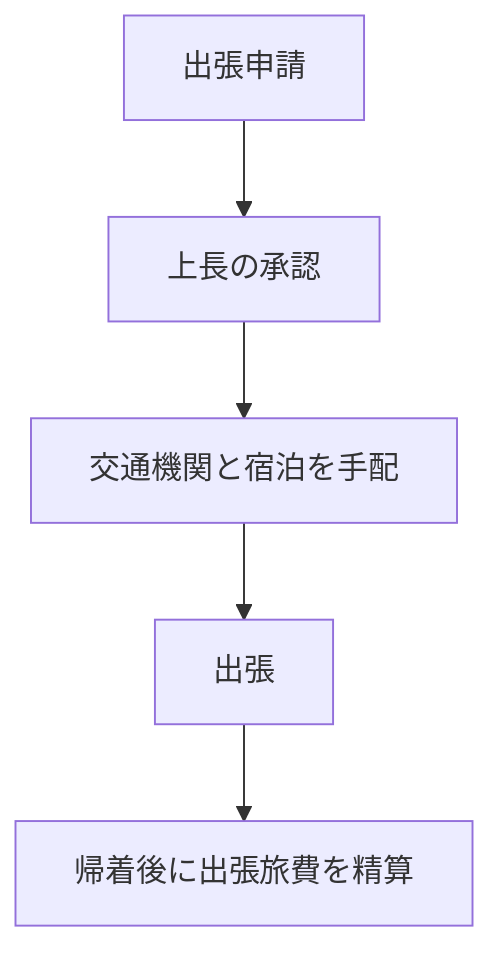
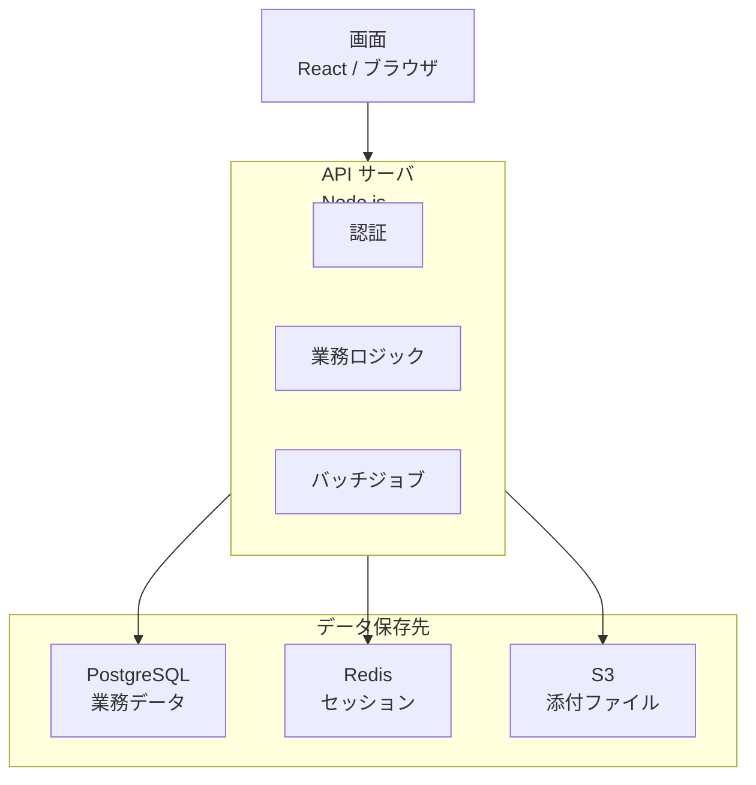
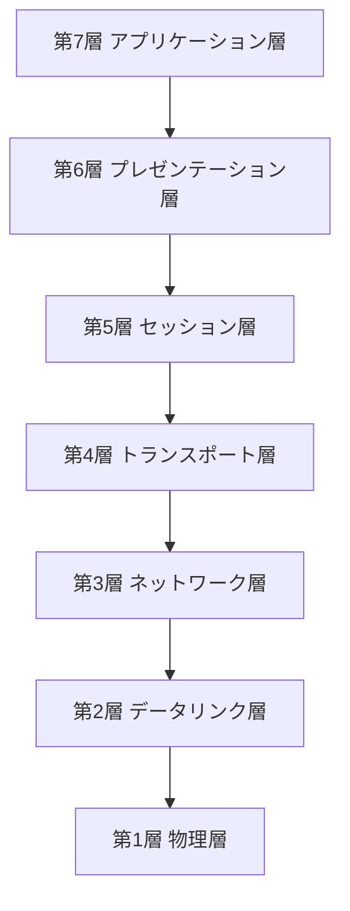
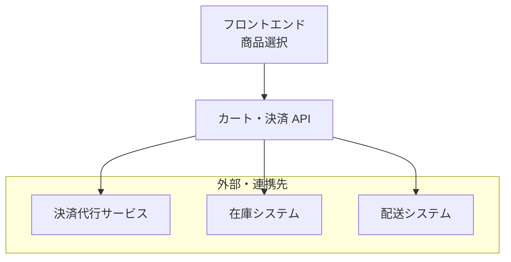

=== TASK flow-001 ===
経費精算の流れは次のとおりです。

資料には、経理部の確認で問題があった場合の扱いは書かれていません。
=== TASK flow-007 ===
デプロイの流れは次のとおりです。

資料には、責任者が承認しなかった場合の扱いは書かれていません。
=== TASK flow-014 ===
出張の手続きの流れは次のとおりです。

資料には、上長が承認しなかった場合の扱いは書かれていません。
=== TASK stack-001 ===
Web アプリの構成は次のとおりです。

資料には、API サーバ内の各機能がどの保存先を使うかまでは書かれていないため、API サーバ全体から各保存先へつないでいます。
=== TASK stack-006 ===
OSI 参照モデルの7階層を上から順に示します。

=== TASK stack-011 ===
EC サイトのシステム構成は次のとおりです。

