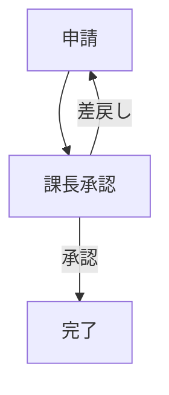
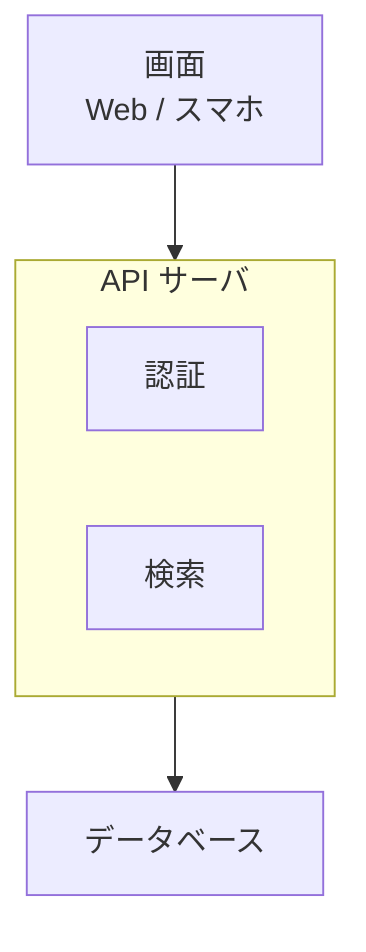

[system]（全課題で共通）
あなたは企業向けの AI アシスタントです。日本語で、参考資料に基づいて簡潔に回答します。資料に無いことは推測せず、その旨を伝えます。

# 図の書き方（Mermaid）

流れ図や構成図が理解を助けるときだけ、回答の文章の中に ```mermaid ブロックで flowchart を書く。図が不要な質問では使わない。

## 流れ図


## 構成図
上から下へ `flowchart TB` で層を並べ、層の中の要素は subgraph で囲む。


=== TASK flow-001 ===

[user]
# 参考資料

[1]
経費精算の手順です。申請者が経費精算書を提出すると、上長が内容を承認します。承認された場合は経理部が内容を確認し、問題がなければ支払を行います。上長が差し戻した場合は、申請者が修正して再度提出します。

# 質問
経費精算の流れを図にしてください。

=== TASK flow-007 ===

[user]
# 参考資料

[1]
開発チームのリリース手順: コードをプッシュするとビルドが走り、続いて自動テストを実行する。テストが失敗した場合は開発者に通知する。成功した場合はステージング環境へデプロイし、責任者の承認を得てから本番環境へデプロイする。

# 質問
デプロイの流れをフローチャートで。

=== TASK flow-014 ===

[user]
# 参考資料

[1]
出張規程: 出張する場合は事前に出張申請を行い、上長の承認を得る。承認後に交通機関と宿泊を手配し、出張に行く。帰着後は出張旅費を精算する。

# 質問
出張の手続きを流れで示してください。

=== TASK stack-001 ===

[user]
# 参考資料

[1]
業務システムの構成: 利用者はブラウザ上の React で作った画面から操作する。画面は API サーバ（Node.js）と通信し、API サーバの中には認証、業務ロジック、バッチジョブの3つの機能がある。データは PostgreSQL に保存し、セッションは Redis、添付ファイルは S3 に置く。

# 質問
このWebアプリの構成を図にしてください。

=== TASK stack-006 ===

[user]
# 参考資料

[1]
OSI 参照モデルは、通信機能を7つの階層に分けたモデルである。上から順に、アプリケーション層、プレゼンテーション層、セッション層、トランスポート層、ネットワーク層、データリンク層、物理層となる。

# 質問
OSI 参照モデルの7階層を上から図で示して。

=== TASK stack-011 ===

[user]
# 参考資料

[1]
ECサイトの構成: 利用者はフロントエンドから商品を選ぶ。フロントエンドはカート・決済 API を呼び出す。カート・決済 API は外部の決済代行サービス、在庫システム、配送システムと連携する。

# 質問
ECサイトのシステム構成を図で示して。

